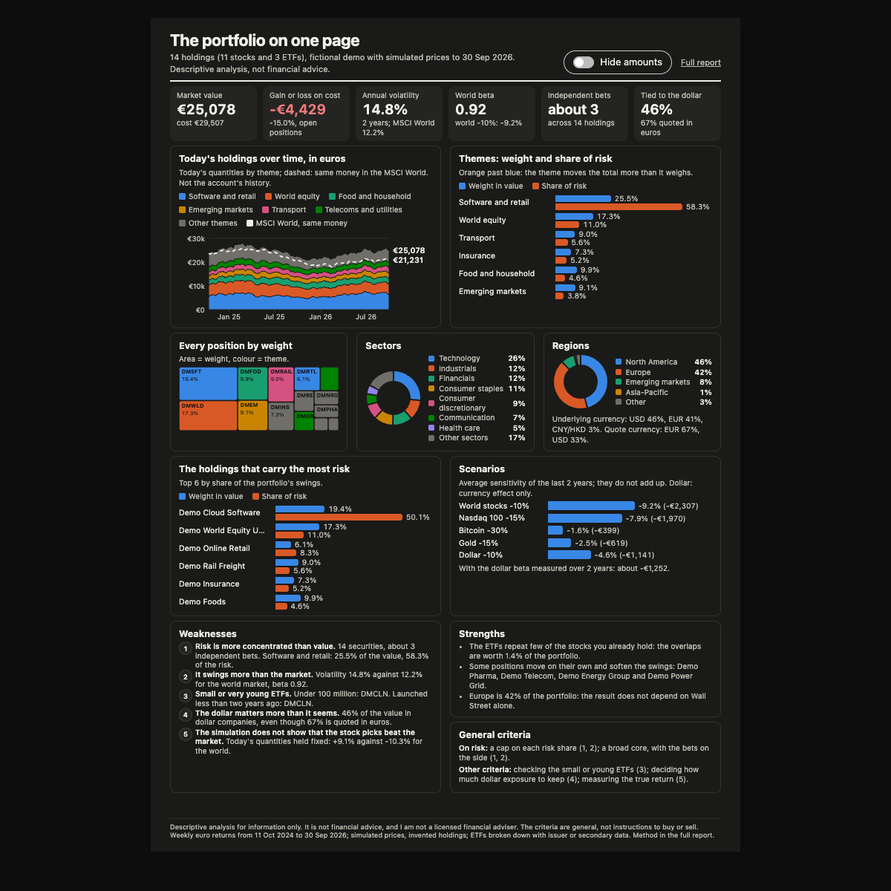
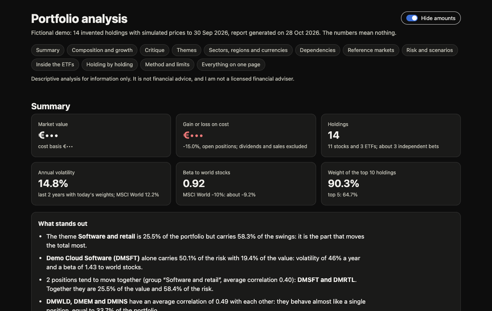

# portfolio-report

A Claude Code skill that turns a Fineco portfolio export into a full English portfolio analysis: an interactive report, an A4 one-pager and two PDFs, one of them with the euro amounts masked.



> **Independent project.** Not affiliated with or endorsed by FinecoBank, Yahoo, or the owners of the indexes and funds it names (MSCI, Nasdaq, STOXX, FTSE Russell, S&P and Select Sector SPDR, iShares, Invesco); their names belong to them.
> Descriptive analysis for information only: it is not financial advice.

## What it does

- Asks first: which export, which workspace, and whether to research new ETFs on the web.
- Reads the export, fetches about 3 years of daily prices from Yahoo Finance and computes, in euros:
  - weights by theme, sector, region and currency, with ETFs broken down into what they hold;
  - volatility, correlations, clusters of holdings that move together, betas to world markets, gold, Bitcoin and the dollar;
  - each holding's share of the risk, simple scenarios, drawdowns and the value of today's holdings over time against the MSCI World;
  - overlaps between the ETFs and the stocks held directly;
  - a critique with weak points, strengths and general portfolio-construction criteria.
- Remembers your portfolio between runs (`portfolio_meta.json`), so a new export only needs the new securities described. Earlier runs are archived and the reply says what changed.
- Hands over `report.html`, `onepager.html`, `onepager.pdf` and `onepager-hidden.pdf`.

What it never does: give buy or sell advice, log in to your bank, send your holdings or amounts anywhere except ticker symbols and ISINs to Yahoo Finance, or publish anything.

## Hide amounts

Both pages have a **Hide amounts** switch at the top. It masks every euro figure (KPIs, tables, chart axes, tooltips) and keeps the percentages. The page remembers the choice; `#hide` at the end of the address opens it hidden.



The switch only changes what the screen and the printout show: the HTML file still contains the data. To share, use `onepager-hidden.pdf`.

## The intake questions

1. Which export file (default: the newest `portafoglio*.xls` in Downloads)?
2. Which workspace (the last one, a new `~/portfolio-report/<name>/`, or a folder you name)?
3. Research new ETFs on the web (only fund names and ISINs are searched), or show them as "not broken down"?
4. No export yet? Try the fictional demo.

## Install

```bash
git clone https://github.com/Matteoikarieth96/portfolio-report-skill ~/.claude/skills/portfolio-report
python3 -m venv ~/.claude/skills/portfolio-report/.venv
~/.claude/skills/portfolio-report/.venv/bin/pip install -r ~/.claude/skills/portfolio-report/scripts/requirements.txt
```

Requirements:

- macOS or Linux (Windows is untested).
- Python 3.12 or newer, with the pinned packages in [scripts/requirements.txt](scripts/requirements.txt) (numpy, pandas, scipy, xlrd).
- `curl` (Yahoo Finance answers it, not Python HTTP clients).
- Google Chrome or Chromium for the PDFs (optional), `pdfinfo` from poppler to check the page count (optional).
- A Fineco portfolio export: in the Fineco web app, Portafoglio, then the export icon. At the time of writing (October 2026) Fineco has no public API or MCP server for private customers ([developer portal FAQ](https://devportal.finecobank.com/faq)), so this step is manual.

## Usage

In Claude Code:

> Here is my new portfolio export: portafoglio-export.xls in my Downloads folder

Or try it without an export:

```bash
~/.claude/skills/portfolio-report/.venv/bin/python ~/.claude/skills/portfolio-report/scripts/make_demo.py --out /tmp/portfolio-demo
~/.claude/skills/portfolio-report/.venv/bin/python ~/.claude/skills/portfolio-report/scripts/analyze.py --workspace /tmp/portfolio-demo
open /tmp/portfolio-demo/report.html    # on Linux: xdg-open
```

The demo's 14 companies and funds are invented (tickers start with `DM`, ISINs with the unassigned code `ZZ`) and its prices are simulated: its numbers mean nothing, and the pages say so. `make_demo.py` only writes into a new, empty folder.

## Security and privacy

Your holdings stay on your machine. The only network calls are to Yahoo Finance (ticker symbols and ISINs, no quantities or amounts) and, if you agree, web searches for new ETFs by fund name and ISIN. The skill tells Claude to treat the export and every web page as data, never as instructions. Details and residual risks: [SECURITY.md](SECURITY.md).

## Limitations

- Reads only Fineco's portfolio export (Italian column names). Another broker needs a new parser in `scripts/fetch.py`.
- Yahoo Finance's endpoints are unofficial and can change or rate-limit without notice; their use is subject to Yahoo's terms (personal use).
- "MSCI World" is measured through an ETF that tracks it (EUNL.DE), not the index itself.
- Holdings without prices on Yahoo (delisted, very new) are left out of the analysis and listed in the pages.
- It looks at open positions only: no dividends, sales, fees or taxes, so it is not your real return.
- Betas and correlations come from two years of weekly returns: short histories (under a year) are marked as fragile.
- ETF look-through is as good as the sources found; dates and sources are written in each `data/etf_*.json`.
- The one-pager is tuned to fit one A4 page; very long holding names can push it to two.

## Tests

```bash
cd ~/.claude/skills/portfolio-report && .venv/bin/python -m unittest discover -s tests -v
```

They run offline on the fictional demo; the masking test needs `node` and is skipped without it. CI runs them on every push and pull request, on Python 3.12 and 3.13.

## More skills

- [claude-time-is-relative](https://github.com/Matteoikarieth96/claude-time-is-relative): time estimates for Claude Code tasks, learned from your own past sessions
- [token-checkup-skill](https://github.com/Matteoikarieth96/token-checkup-skill): a weekly token checkup for Claude Code
- [adversarial-review-skill](https://github.com/Matteoikarieth96/adversarial-review-skill): a panel of independent reviewer agents challenges finished work
- [skill-release-skill](https://github.com/Matteoikarieth96/skill-release-skill): take a skill to a public GitHub repo without leaking anything
- [ai-privacy-check-skill](https://github.com/Matteoikarieth96/ai-privacy-check-skill): privacy and AI rules check for a use case in Italy and the EU (in Italian)
- [hiring-prep-skill](https://github.com/Matteoikarieth96/hiring-prep-skill): one interview prep page from a company, a role and your resume
- [evm-dd-skill](https://github.com/Matteoikarieth96/evm-dd-skill): investor-angle due diligence on crypto and EVM projects
- [whiteboard-video-skill](https://github.com/Matteoikarieth96/whiteboard-video-skill): hand-drawn whiteboard explainer videos with voice-over
- [3d-print-design-skill](https://github.com/Matteoikarieth96/3d-print-design-skill): FDM 3D-printable parts in code, from questions to a checked STL
- [beer-can-label-skill](https://github.com/Matteoikarieth96/beer-can-label-skill): print-ready beer can labels with a 3D preview
- [breadboard-wiring-guide-skill](https://github.com/Matteoikarieth96/breadboard-wiring-guide-skill): step-by-step breadboard wiring guides for Arduino UNO
- [cartoon-shorts](https://github.com/Matteoikarieth96/cartoon-shorts-skill): animated cartoon shorts (9:16) for YouTube Shorts, TikTok and Reels, interview first, rendered locally

## Licence

MIT, see [LICENSE](LICENSE).
